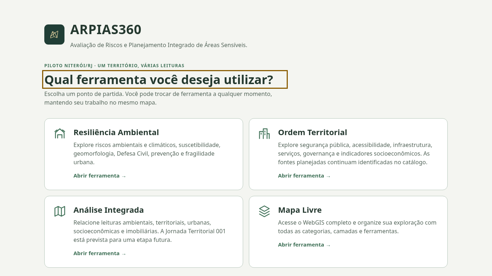
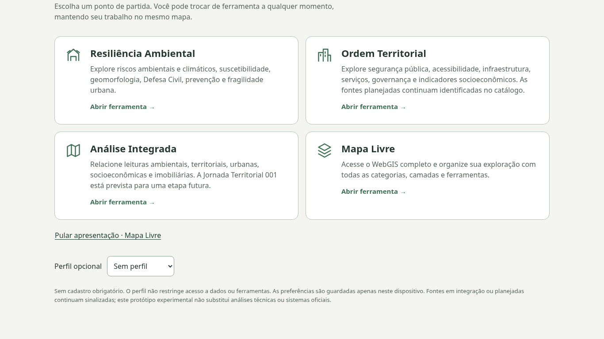
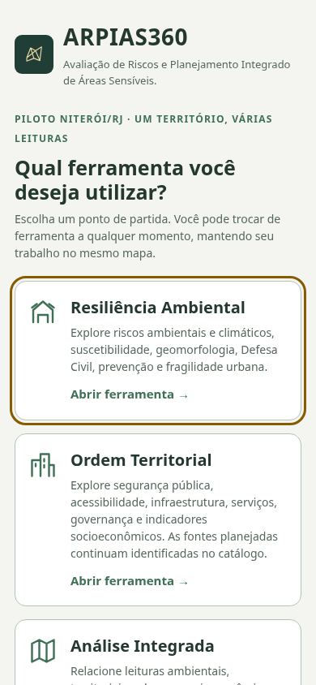
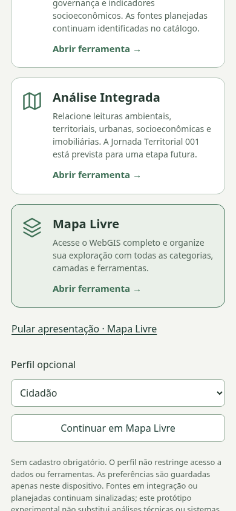

# Fase 1 — Estabilização do PR #6

## Estado inicial e histórico

Repositório oficial: `tar80475arquitetura/arpias360-piloto`.

- main: `a02dabd2e89ae9b77e0c9e4d5275066cb204102a`.
- PR #5: `codex/painels-moveis`, `6133c1f0409de9056319cf1ea573959a94c27b23`.
- PR #6: `codex/fe02-portal-ferramentas`, `e442a3b077e613eeb5f4a047374e83a41e0f7b2b`, descendente de #5.
- Ambos abertos, mergeable e com CI aprovada; worktree limpa antes de editar.

PR #5 estabilizado primeiro em `30b5f617767c1a89477999e3c6d557f0db8345c6`, com **CI SUCCESS** ([execução 38167901055](https://github.com/tar80475arquitetura/arpias360-piloto/actions/runs/38167901055)), 107 unitários/34 grupos. Diagnóstico e correção estão no [relatório próprio](../fase1-pr5/README.md).

O commit foi incorporado ao #6 por merge normal `0de370489a874116714bc9f6a894248af9a20006`. Houve um conflito inequívoco em `tests/browser-operations.py`: cada branch acrescentava uma suíte ao final. As duas chamadas foram preservadas, sem alterar contratos ou expectativas. Não foi feito rebase, force-push, merge de PR ou exclusão de branch.

## Hierarquia visual

Os quatro cartões continuam sendo as opções principais. **Pular apresentação · Mapa Livre** foi movido para abaixo de todos os cartões e virou uma ação secundária com fundo transparente e texto sublinhado, mantendo botão nativo, alvo mínimo de 44 px, foco visível e acesso direto.

O Tab inicial agora alcança Resiliência Ambiental, seguido pelos outros cartões, depois o atalho e as preferências opcionais. As expectativas de ordem foram atualizadas para esse contrato visual solicitado, sem desativar verificações.

## Legenda de maturidade

O texto passa a ter o título **Legenda de maturidade das camadas** e explicar que maturidade e estado operacional são distintos. Disponibilidade depende das fontes externas e da verificação no ambiente público; testes locais/simulados não comprovam homologação GIS. Carregamento, visibilidade e trabalho continuam independentes.

`publicStatus()`, `data-state`, categorias de maturidade, catálogo, fontes e metadados não foram alterados. Não há classificação geral de indisponibilidade nem novos indicadores.

## Foco: defeito reproduzido e correção

No desktop, com Camadas aberto e rolado até o final, voltar do portal focava `toolModeSelect` em **y = −3231**, fora da área visível. `focus-baseline.json` registra a reprodução no merge `0de3704`, antes da correção do portal.

O destino agora precisa estar visível, sem ancestral oculto/inert, dentro da janela e das áreas de recorte/rolagem. Se o seletor está fora da área visível ou recolhido, usa o cabeçalho móvel do painel. Com Camadas fechado, usa o retorno no cabeçalho principal. O foco não abre/fecha painéis ou muda a geometria/câmera do mapa.

## Testes e rastreabilidade

- **111/111 unitários**, zero falhas ou ignorados.
- **43 grupos de navegador**: 14 operacionais, 11 Rodada 02, 4 FE-01A, 2 mobilidade, 3 ciclo de vida e 9 portal.
- Novos cenários em **1366×768, 390×844 e 320×568**: abertura e foco inicial; cada ferramenta por mouse e Tab/Enter; foco após entrada/retorno; troca com Camadas aberto; controles realmente visíveis, sem hidden/inert; painel rolado/recolhido; tela cheia/retorno; seleção, trabalho e medição preservados.
- O caso de entrada a partir de painel recolhido chama a API existente `ARPIASPortalUI.show()` para verificar o componente; os demais retornos usam botões reais. Não é uma homologação manual de usuário final.
- Regressões de seis resoluções e zoom nativo 200% mantidas. Contraste ≥4,5:1 e hierarquia do atalho conferidos no DOM real.
- Sintaxe JS/Python, diff check e integridade de ancestralidade aprovados.

Os resultados locais deste diretório foram capturados antes do commit, com SHA de base/merge e worktree modificada. `manifest.json` contém hashes do código exercitado e dos arquivos novos. O HEAD final é validado pela CI do PR, com identificação do head no workflow e artefatos; a entrega registra SHA final e URL dessa execução. As evidências anteriores em `tests/evidence/fe02` e `tests/evidence/panels` continuam preservadas e representam versões anteriores.

Leaflet/Esri obtidos com TLS normal; GIS externo recebe **503 simulado**. Geometrias de seleção dos testes são fixtures, sem edição de dados oficiais. Isso valida frontend, falhas e dados locais, não serviços GIS reais, GPS ou site publicado.

## Capturas novas

| Desktop: cartões principais | Desktop: atalho abaixo dos cartões |
|---|---|
|  |  |

| Celular: cartões primeiro | Celular: atalho secundário abaixo |
|---|---|
|  |  |

[Tablet — início](fase1-fe02-tablet-portal.png) · [Tablet — ação secundária](fase1-fe02-tablet-shortcut.png).

[Contexto desktop](fase1-fe02-desktop-resilience.png) · [Contexto no celular](fase1-fe02-mobile-resilience.png).

[Legenda completa — desktop](fase1-fe02-desktop-maturity.png) · [Legenda completa — celular](fase1-fe02-mobile-maturity.png). O painel tem rolagem própria.

## Integridade, pendências e Fase 2

Os novos testes preservam o mesmo mapa, camadas, trabalho, seleção, desenhos, medidas, consulta, relatórios, fichas, busca, preferências, compartilhamento, responsividade e mobilidade. Nenhuma alteração em fontes/dados, geometrias oficiais, IFUC ou Jornada Territorial 001. Nenhuma nova dependência.

Sem alterações em main/Pages, publicação ou comentários em PRs. Somente descrições dos PRs existentes são atualizadas com os resultados. Após confirmação da CI do HEAD final do #6, os dois PRs podem seguir para nova verificação técnica e Fase 2. Integração exige autorização expressa do proprietário; a homologação pública permanece pendente dessa etapa.
