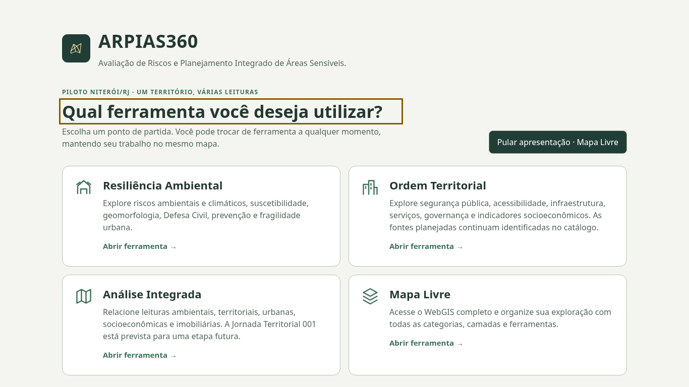
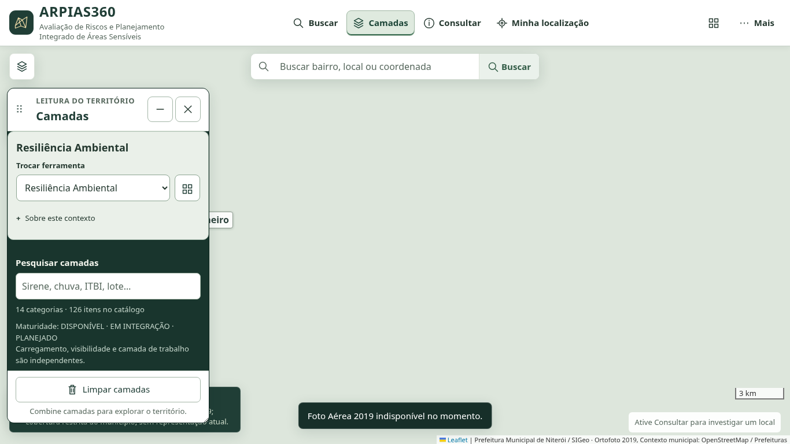
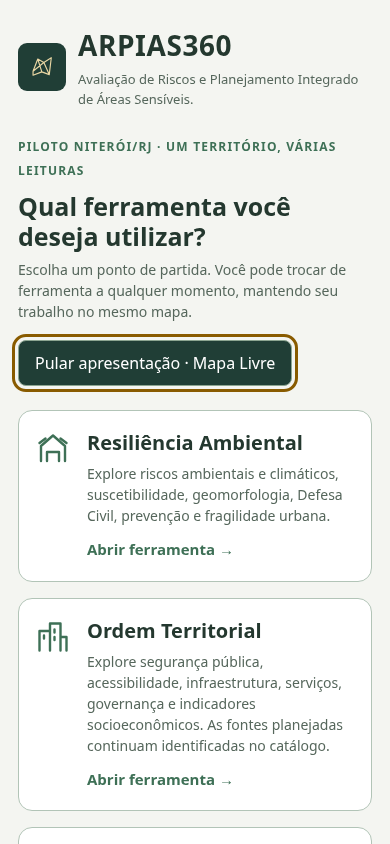
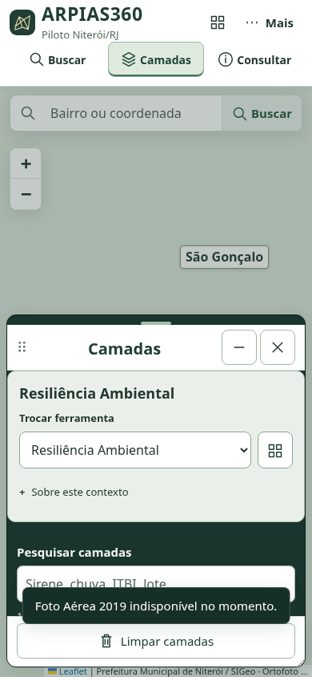

# FE-02 — Capturas e resultados locais

Frontend real em Chromium 151: desktop **1366×768** e celular **390×844**. Todas as capturas são do estado de trabalho FE-02 antes do commit, com base `6133c1f0409de9056319cf1ea573959a94c27b23`. Os JSON registram horário UTC, SHA-base e worktree modificada; `manifest.json` registra hashes das imagens, resultados e código exercitado. O SHA final da entrega e a CI identificam o commit consolidado.

**111/111 testes unitários e 37 grupos de navegador aprovados**, sem testes ignorados. Resultados brutos: `unit-results.txt`, `results.json` (14 operacionais), `round2-results.json` (11), `fe01a-results.json` (4), `panels-results.json` (2), `portal-results.json` (6). A matriz completa de detalhes do FE-01A está preservada em `fe01a-results.full.json.gz`; o JSON resumido registra seu hash. A nova suíte também confere contraste dos textos ≥ 4,5:1 e seis resoluções.

As fontes externas GIS recebem 503 simulado; Leaflet/Esri usam CDN obtido com TLS normal. Os mapas sem mosaico nas imagens ilustram a falha controlada. Não representam publicação, homologação GIS real nem GPS físico. O mapa e os controles locais continuam funcionando. As capturas anteriores do [PR #5](../panels/README.md) são preservadas como referência da mobilidade.

| Portal desktop | Contexto no mesmo mapa |
|---|---|
|  |  |

[Parte inferior do portal desktop com perfil opcional](fe02-desktop-portal-profile.png).

| Portal no celular | Contexto no painel móvel |
|---|---|
|  |  |

[Continuação dos cartões no celular](fe02-mobile-portal-options.png). O portal tem rolagem própria; a imagem inicial não corta ou remove os cartões inferiores.

Instruções de acesso, arquitetura, links e dependência do PR #5: [relatório técnico](../../../docs/FE02_PORTAL_FERRAMENTAS.md).
